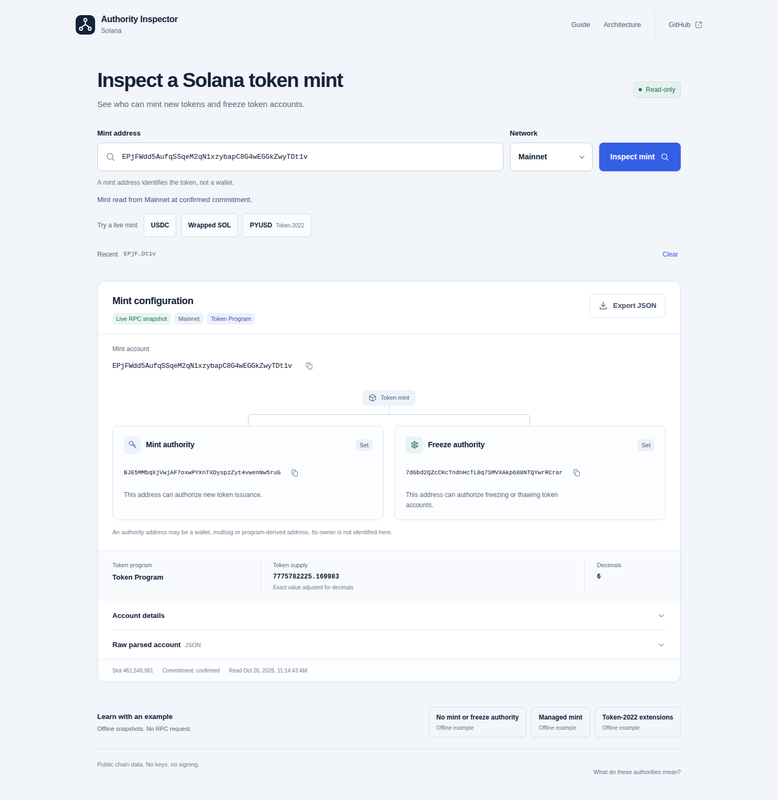
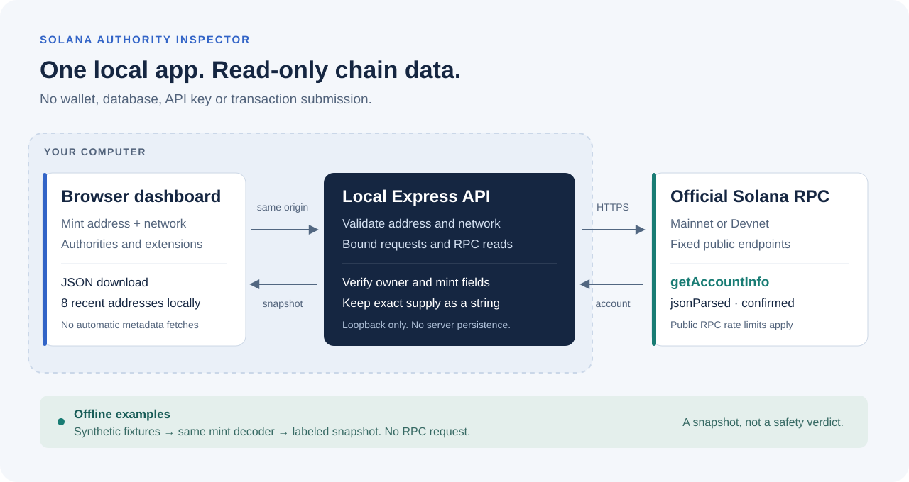

# Solana Authority Inspector



[](https://github.com/royalpinto007/solana-authority-inspector/actions/workflows/ci.yml)
[](LICENSE)

Paste a Solana token mint address. Read its authorities, token program and configuration directly from chain, with plain explanations and an exportable snapshot.

## Run locally

Requires Node.js **22.18+**.

```sh
git clone https://github.com/royalpinto007/solana-authority-inspector.git
cd solana-authority-inspector
npm install
npm run demo
```

Open **http://127.0.0.1:4410**. No wallet, API key or funds needed. Choose Mainnet or Devnet for a live lookup, or load a clearly labeled synthetic example offline.

## What you get

- Mint and freeze authorities, with copyable addresses.
- Token Program and Token-2022 support, including RPC-parsed extensions.
- Exact supply, decimals, slot and observation time.
- JSON export with the original account response.
- Local dashboard, in-app guide and architecture diagram.

The server makes read-only calls to Solana's fixed public RPC endpoints. Your browser remembers up to eight lookup addresses; the server stores nothing. No database, telemetry, remote token images or metadata requests.

## Read the result carefully

This is a configuration snapshot, not a token safety verdict. An absent authority does not establish whether it was revoked. Token-2022 extensions can add other powers. Native wrapped SOL mint supply is not circulating supply. Public RPC endpoints can throttle requests. [Guide and limitations](docs/guide.md).

## Develop

```sh
npm run check
npx playwright install chromium
npm run test:e2e
```



[Architecture](docs/architecture.md) · [Local API](docs/api.md) · [Contributing](CONTRIBUTING.md) · [Feedback](https://github.com/royalpinto007/solana-authority-inspector/issues/new?template=feedback.yml)

MIT licensed. Not published to npm.
